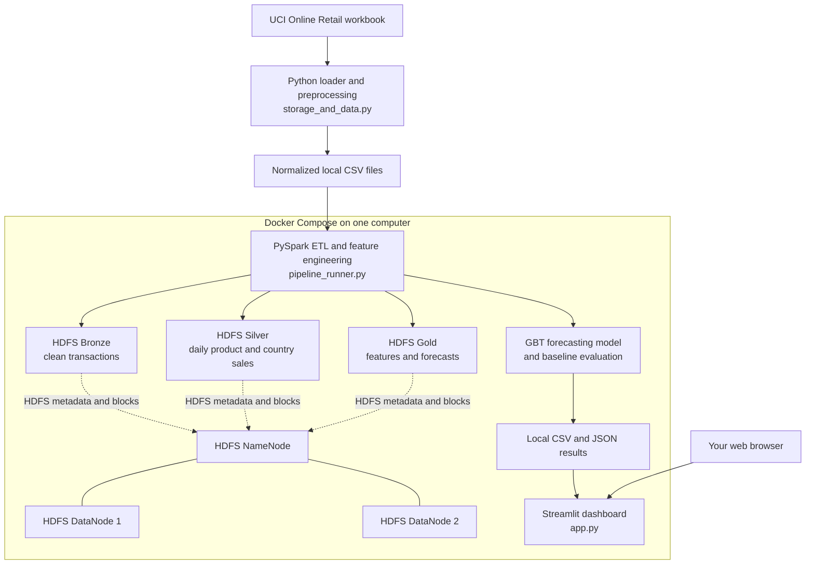

# Market Demand Forecasting: Project and Pipeline Guide

This project is a learning workbench for Big Data Analytics (BDA). It uses the free UCI Online Retail dataset to demonstrate data cleaning, distributed storage, PySpark processing, demand forecasting, evaluation, and dashboards.

The project has two related parts:

1. **BDA demonstrations** in the Streamlit app. These illustrate concepts such as MapReduce, stream summaries, clustering, similarity, and storage.
2. **An end-to-end data pipeline** that reads the same UCI retail data, processes it with PySpark, writes Parquet data to a real local HDFS cluster, trains and evaluates a forecast model, and displays its results in the app.

All services run on your computer through Docker Desktop. No paid cloud services are used. The source dataset is downloaded from UCI on the first run if it is not already cached.

## 1. Project architecture



### What each part does

- **UCI dataset:** historical online retail transactions. The source has invoice, product, quantity, price, date, customer, and country fields.
- **Python loader:** downloads and extracts the UCI workbook, standardizes its columns, removes invalid sales and cancellation invoices, and caches normalized CSV files locally.
- **PySpark:** reads the normalized sales CSV, validates and cleans it again, aggregates demand, creates features, trains a model, and writes Parquet datasets.
- **HDFS:** stores the pipeline's Parquet datasets in a NameNode and two DataNode containers. These are real Hadoop HDFS processes, but they all run on the same physical computer.
- **Streamlit:** presents the project concepts and pipeline outputs in a browser UI.
- **Local results folder:** holds compact CSV and JSON files so Streamlit can display evaluation details and forecasts.

## 2. Prerequisites and startup

- Windows with Docker Desktop installed and its Docker engine running.
- Internet access for the initial image builds and UCI dataset download.
- Several GB of free disk space for Docker images, the cached dataset, and HDFS data.

Open PowerShell in this project folder and start the full stack:

```powershell
docker compose up --build
```

Docker builds the app and Hadoop images, starts HDFS, runs the PySpark pipeline, and then starts Streamlit. The first start can take several minutes. Later starts are faster, but the Compose app command reruns the pipeline before opening the dashboard.

Open:

- **Application:** <http://localhost:8501>
- **HDFS NameNode status and file browser:** <http://localhost:9870>

To run the stack in the background instead, use `docker compose up --build -d`. Then view logs with `docker compose logs -f app`.

To stop the services, press `Ctrl+C` if running in the foreground, then run:

```powershell
docker compose down
```

This stops containers but keeps named HDFS volumes. `docker compose down -v` also deletes those HDFS volumes and their stored data.

## 3. End-to-end data pipeline

### Stage 1: Source and Python preprocessing

`storage_and_data.py` downloads the official UCI Online Retail workbook when no valid local cache exists. It normalizes the workbook into:

- `hdfs_sim/online_retail/sales_transactions.csv` — one row per cleaned sales line.
- `hdfs_sim/online_retail/products.csv` — product descriptions, median prices, and total units sold.
- `hdfs_sim/online_retail/dataset_metadata.json` — source and preprocessing metadata.

The loader removes rows missing required values, cancellation invoices, nonpositive quantities or prices, and nonnumeric product codes. This Python preprocessing happens before Spark reads the normalized CSV. PySpark then validates and cleans the records again as part of the pipeline.

### Stage 2: PySpark validation and cleaning

`pipeline_runner.py` reads the sales CSV using an explicit schema. It removes rows missing required fields, nonpositive quantity or price, blank product or country values, and exact duplicate rows.

### Stage 3: Aggregation and HDFS storage

The pipeline creates and writes these Parquet datasets under `hdfs://namenode:9000/market-demand`:

| Layer | HDFS path | Contents |
|---|---|---|
| Bronze | `/market-demand/bronze/sales_transactions` | Cleaned transaction lines |
| Silver | `/market-demand/silver/daily_product_market` | Daily product sales grouped by country |
| Gold | `/market-demand/gold/daily_product_features` | Daily product demand and model features |
| Gold | `/market-demand/gold/product_demand_forecasts` | Forecasts and demand-only inventory proxies |

Daily product-and-country sales are aggregated first. Forecasting then combines those markets to produce one time series per product. Dates with no recorded product sales are filled with zero in those product-level series.

### Stage 4: Forecast features

For each product and date, the model uses:

- Sales from 1, 7, 14, 21, and 28 days earlier.
- Average sales across the previous 7 and 28 days.
- Average sales on the same weekday over the previous four weeks.
- Weekday, month, and the product's median observed unit price.

The value it learns to predict is **units sold for that product on a day**. Forecasts are per product overall, not per country or individual store.

### Stage 5: Model and evaluation

The model is Spark ML's **Gradient-Boosted Trees regressor**. The last 30 days in the dataset are held out for evaluation; earlier dates are used for training. It is compared with three simple forecasts:

1. The average sales over the previous 7 days.
2. Sales on the same day of the previous week.
3. The average sales on that weekday over the previous 4 weeks.

The dashboard reports:

- **MAE:** average absolute error in units. Lower is better.
- **RMSE:** error that penalizes large misses more heavily. Lower is better.
- Error by actual daily demand bands (zero, low, medium, and high sales).
- Per-product results for the 20 highest-volume products in the held-out period.

The next-day model estimate is also multiplied by seven for a simple seven-day projection. This holds the next-day value flat across all seven days; it is a demonstration and does not simulate each future day separately.

### Stage 6: Inventory signals

The pipeline displays a reorder-point proxy that uses an assumed 7-day lead time and a demand buffer. The dataset has no current stock, purchase orders, supplier lead times, or store IDs. Treat this as an educational calculation, **not an operational order recommendation**.

## 4. What the latest evaluation says

The current saved evaluation is from one 30-day historical holdout. Results can change if the source data or pipeline changes.

| Forecast | MAE (units) | RMSE (units) |
|---|---:|---:|
| Gradient-Boosted Trees model | 8.97 | 273.69 |
| Previous 7-day average | 9.43 | 273.68 |
| Previous week's same weekday | 10.24 | 274.90 |
| Previous 4 weeks' same-weekday average | 9.28 | 273.89 |

The model has a slightly lower overall MAE, but its RMSE is about the same as the 7-day average. In the over-100-units demand segment, the model's MAE is about 230.80 units, compared with 221.28 for the 7-day average. That means the current model has not shown a reliable advantage for high-volume demand. Use the demand and per-product breakdowns in the dashboard to see where it succeeds or misses.

## 5. Application tabs

The app at <http://localhost:8501> has these tabs:

| Tab | What it demonstrates |
|---|---|
| **[0] Decision Dashboard** | Historical revenue, orders, customers, and product or market views for exploring the dataset. |
| **[1] Storage Concepts (Simulation)** | A local illustration of HDFS-style blocks and metadata. This tab is a simulation; the end-to-end pipeline separately uses real HDFS containers. |
| **[2] MapReduce Execution** | Map/reduce-style sales aggregation and join traces. These are educational demonstrations, not Hadoop MapReduce jobs. |
| **[3] Stream Mining Engine** | Streaming summaries such as Bloom filters, DGIM, and Flajolet-Martin cardinality estimation. |
| **[4] Similarity & Clustering** | Product text similarity and product clustering demonstrations. |
| **[5] Demand Forecasting** | A separate per-product historical forecasting walkthrough using a simple method. It is not the PySpark Gradient-Boosted Trees model. |
| **[6] End-to-End Pipeline** | PySpark model metrics, baseline comparisons, validation breakdowns, forecast charts, and HDFS paths. |

In tab **[6]**, the forecast bars are displayed side by side to make comparison with the recent-sales baseline easier. The top-demand chart ranks products using the ML model's projected units.

## 6. Architecture and limitations to understand

- **HDFS is real, but local:** Docker runs one NameNode and two DataNodes with replication factor 2. Since all containers share one computer, this is not protection against that computer failing.
- **Some app concepts remain simulations:** the original storage tab, MapReduce traces, and JSON document-store helper are educational local implementations. They are not distributed HDFS, Hadoop MapReduce, or a production NoSQL service.
- **The dataset is historical:** UCI Online Retail covers December 2010 through December 2011. It does not represent live retail demand.
- **No store-level forecasts:** country is used as a market grouping in one aggregate table, but the forecast series combine countries because the source has no store identifier.
- **No operational inventory inputs:** inventory, supplier lead times, promotions, and holiday calendars are unavailable.
- **Model quality is limited:** this is a learning pipeline, not a production planning system. A single final-month holdout cannot establish how well the model will work in future periods.
- **The trained model is not persisted:** each pipeline run trains the model in memory, uses it for evaluation and forecasts, and then exits. Forecasts and metrics are saved, but the reusable model itself is not saved or versioned.

## 7. Output locations

Local outputs written by the pipeline (ignored by Git):

- `pipeline_outputs/pipeline_summary.json` — data counts, evaluation metrics, dates, HDFS paths, and caveats.
- `pipeline_outputs/product_forecasts.csv` — next-day and seven-day product forecast results.
- `pipeline_outputs/validation_demand_segments.csv` — validation metrics grouped by actual daily demand.
- `pipeline_outputs/validation_top_products.csv` — validation results for the highest-volume products.

The Parquet datasets are stored in Docker's named HDFS volumes. The NameNode web UI at <http://localhost:9870> can be used to inspect the HDFS namespace.

## 8. Main source files

| File | Responsibility |
|---|---|
| `app.py` | Streamlit UI, dashboards, and the seven application tabs. |
| `storage_and_data.py` | UCI download, Python preprocessing, local dataset cache, and the original storage/JSON simulations. |
| `pipeline_runner.py` | PySpark schema, validation, ETL, features, model training/evaluation, forecasts, and HDFS writes. |
| `bigdata_algorithms.py` | MapReduce-style traces, stream algorithms, similarity, clustering, and the original simple forecast helper. |
| `docker-compose.yml` | App, NameNode, and two DataNode services plus volumes and ports. |
| `Dockerfile` | Python, Spark, and Streamlit app image. |
| `docker/hadoop/` | Hadoop image, HDFS configuration, and container entrypoint. |
| `requirements.txt` | Python dependencies. |
